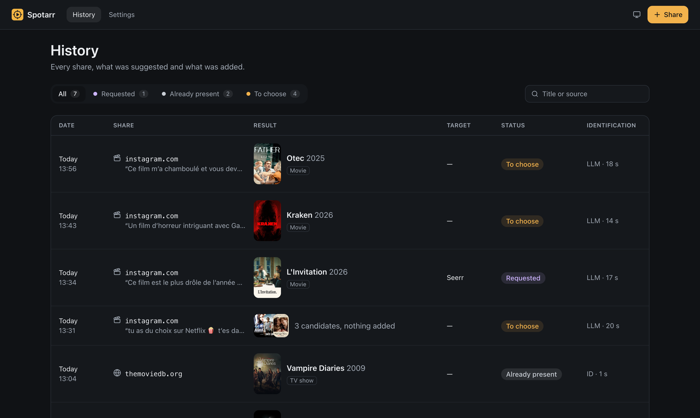

# 🎬 Spotarr

Share any link from your iPhone (a reel, a TikTok, a YouTube video, an article, a film's page on Letterboxd, AlloCiné or Wikipedia): Spotarr finds the movie or TV show it is about, and adds it to your library through Seerr. A personal project, for one user, self-hosted with Docker or on [Umbrel](https://github.com/mathieuletyrant/umbrel-community-app-store).



## ✨ What it does

- 🎞️ **Watches and listens.** A video (Instagram, TikTok, YouTube…) is downloaded, then an LLM looks at a few frames and hears the sound. The title is often only said out loud.
- 📰 **Reads any page.** A page linking to IMDb or TMDB (Letterboxd, Wikipedia) names its work at once, without the LLM. Any other link (an article, AlloCiné, a photo post, a poster) is read by the LLM: the page's title, description, text and pictures.
- 🎯 **Confirms on TMDB.** It keeps the titles that exist on TMDB, with a poster and a confidence. A video or an article naming three films gives three candidates.
- 📚 **Knows your library.** Seerr tells what is already there.
- ➕ **Adds in one click**, or on its own: auto add requests a candidate on its own when one of your rules holds (movies or TV shows, a single candidate, confidence, TMDB rating), with a preview of what each rule would have added. A TV show gets season 1 only.
- 📺 **Says where to watch it already**: pick your country and the streaming platforms you subscribe to (Settings → Streaming), and a candidate streaming on one of them links to it, next to a link to your library (Jellyfin, Plex) when the title is there. No need to add what you can already watch.
- ⭐ **Keeps the rest for later.** A rule can put candidates in Seerr's watchlist instead of requesting them: nothing is downloaded, JellyTV shows them, and a title leaves the watchlist once available. Seerr must use Jellyfin or Emby: it hides its own watchlist from Plex accounts.
- 🖥️ **A web UI** for the history, the candidates and the settings, in light and dark.

## 🏠 Install

**On Umbrel**: add [Mathieu's community app store](https://github.com/mathieuletyrant/umbrel-community-app-store) and install Spotarr. Sign in with the default password umbrelOS shows: it is the API token.

**With Docker Compose**:

```yaml
services:
  spotarr:
    image: ghcr.io/mathieuletyrant/spotarr:latest
    ports:
      - "3000:3000"
    volumes:
      - ./data:/data
    restart: unless-stopped
```

Run `docker compose up -d`, then open http://localhost:3000. The API token is printed in the logs at every start (`docker compose logs spotarr`), and the UI asks for it once. Optional environment variables: `PORT` (default `3000`), `DATA_DIR` (default `/data`), and `API_TOKEN`, which sets the token instead of generating one.

**Then, in Settings**:
1. Paste an [OpenRouter](https://openrouter.ai) API key (or any OpenAI-compatible API) and a [TMDB](https://www.themoviedb.org/settings/api) read access token.
2. Set Seerr's URL and API key.
3. Check that the Status at the top shows everything as Working.

An identification costs about $0.01 with the default model. Settings shows the cost of the last 30 days.

## 📱 Share from the iPhone

**The app** (`apps/ios`) puts Spotarr in the share sheet: share a link from any app, it says "Sent to Spotarr" and closes, or says why it failed with a Retry button. The app itself has three tabs: **History** (filter by status, search, pull to refresh), each Share's page to **Add** a Candidate or retry the identification, and **Settings**.

1. Open `apps/ios/Spotarr.xcodeproj` in Xcode. In both targets' Signing & Capabilities, pick your team (a free Apple account works; its apps must be reinstalled every 7 days).
2. Run it on your iPhone, over Wi-Fi once paired. In the app, set Spotarr's address (`http://umbrel.local:3838` on Umbrel), the API token, and "Test the connection".
3. Through a proxy such as Cloudflare Access, add its headers in **Custom headers**: `CF-Access-Client-Id` and `CF-Access-Client-Secret`, from a service token.
4. In any app (Instagram, TikTok, YouTube, Safari…), Share → More → Spotarr, once; it then stays in the list.

### The Shortcut, without the app

[`shortcuts/Spotarr.shortcut`](shortcuts/Spotarr.shortcut) puts **Spotarr** in the share sheet for links: share one, and a notification says "Sent to Spotarr", or shows Spotarr's error.

1. Open the file on the iPhone (AirDrop it, or open it from GitHub), or on a Mac signed in to the same iCloud account.
2. Add it, then edit it (Shortcuts → Spotarr → ⋯): in the second Text action, replace `PASTE-YOUR-API-TOKEN-HERE` with the API token (Settings → Access → Copy). The first one is Spotarr's address, `http://umbrel.local:3838` on Umbrel.
3. In any app, Share → More → Spotarr. The link shows up in the History.

**From outside home, through Cloudflare Access** (Spotarr itself needs nothing more):

1. In the Cloudflare tunnel, add a public hostname, e.g. `spotarr.example.com`, pointing to the Umbrel's address on port `3838`.
2. In Zero Trust → Access, add an application for that hostname, with two policies. The first is **Service Auth** with a new service token: copy its Client ID and Client Secret, since the secret is shown once. The second is **Allow**, with your email, for the web UI in a browser.
3. In the Shortcut, set the first Text action to `https://spotarr.example.com`, and paste the Client ID and Client Secret into the third and fourth. Then it works at home and away. Left empty, the headers are sent empty, which is fine at home.

If Cloudflare refuses the call, the notification shows its answer instead of "Sent to Spotarr".

The file holds no secret, so it can be shared; once imported, it keeps your token in plain text, so do not share that copy. It is generated by `bun shortcuts/build.ts` (macOS only, signs it with `shortcuts sign`).

<details>
<summary>Build it by hand instead</summary>

New Shortcut, ⓘ → Show in Share Sheet, receiving URLs. Then these actions:

1. **Get Contents of URL**: `http://umbrel.local:3838/api/spotarr.v1.SpotarrService/CreateShare`, method POST.
   - Headers: `Authorization` = `Bearer <your API token>`. Through Cloudflare, also `CF-Access-Client-Id` and `CF-Access-Client-Secret`.
   - Request body: JSON, with one text field `url` = Shortcut Input.
2. **Get Dictionary Value** `share` in Contents of URL.
3. **If** Dictionary Value has any value: **Show Notification** "Sent to Spotarr".
4. **Otherwise**: **Show Notification** "Not sent to Spotarr", with Contents of URL as its body.

</details>

## 🤖 Ask an AI assistant

Spotarr answers MCP (Model Context Protocol) clients at `/mcp`, with two read-only tools: `list_shares`, the History, filterable by genre, text and Summary, each Candidate with its TMDB genres, rating, overview and whether it was added; and `list_genres`, the genres the filter accepts. An assistant like Claude can then pick "a comedy for tonight" among what you shared.

Give your MCP client the MCP URL from Spotarr's Settings → Access (`http://umbrel.local:3838/mcp?token=…` on Umbrel). The token is in the URL because some MCP clients send no header of ours; it only reads, and the API refuses it. Regenerate it there if it leaks: the old URL stops working at once.

## 🛠️ Develop

```
pnpm install --frozen-lockfile
pnpm dev:setup   # once: fills ./data from .env and prints the API token
pnpm dev         # the service on :3000, the web UI on http://localhost:5173
pnpm check       # the whole gate: lint, contract, generated code, types, tests
```

Needs [pnpm](https://pnpm.io) (its version comes from `package.json`), [Bun](https://bun.sh) (`.bun-version`), and `brew install ffmpeg yt-dlp`. Commands, conventions and known traps are in [AGENTS.md](AGENTS.md), and the vocabulary is in [GLOSSARY.md](GLOSSARY.md).

| Path | Role |
| --- | --- |
| 📜 `packages/contract` | Protobuf contract of the API, generated TypeScript |
| 🎨 `packages/design-tokens` | Design tokens, generated CSS variables |
| ⚙️ `apps/server` | The service: Hono on Bun, Connect-RPC, SQLite |
| 🖥️ `apps/web` | The web UI: React, TanStack Router and Query, Tailwind |
| 📱 `shortcuts` | The iOS Shortcut and the script that builds it |
| 🧭 `docs/adr` | Architecture decisions |

Three documented workarounds: Connect-RPC is mounted inside Hono through a small adapter ([ADR 0001](docs/adr/0001-connect-rpc-mounted-in-hono.md)), Kysely talks to `bun:sqlite` through an in-house dialect ([ADR 0002](docs/adr/0002-kysely-over-bun-sqlite-with-custom-dialect.md)), and an Instagram photo post, which yt-dlp cannot read, is read from the Open Graph tags of its public page (`apps/server/src/integrations/instagram/post.ts`): its caption, its author and its first picture only.

Roadmap: [milestones](https://github.com/mathieuletyrant/spotarr/milestones) and the [project board](https://github.com/users/mathieuletyrant/projects/1).

## 📄 License

[MIT](LICENSE).
